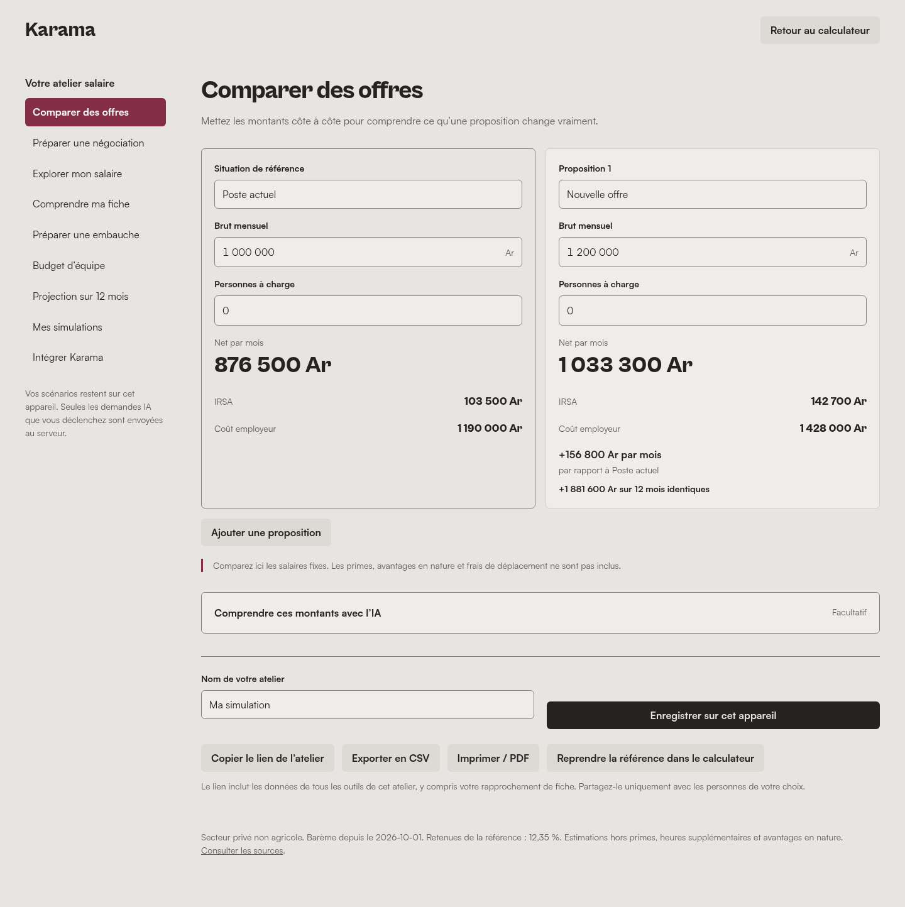
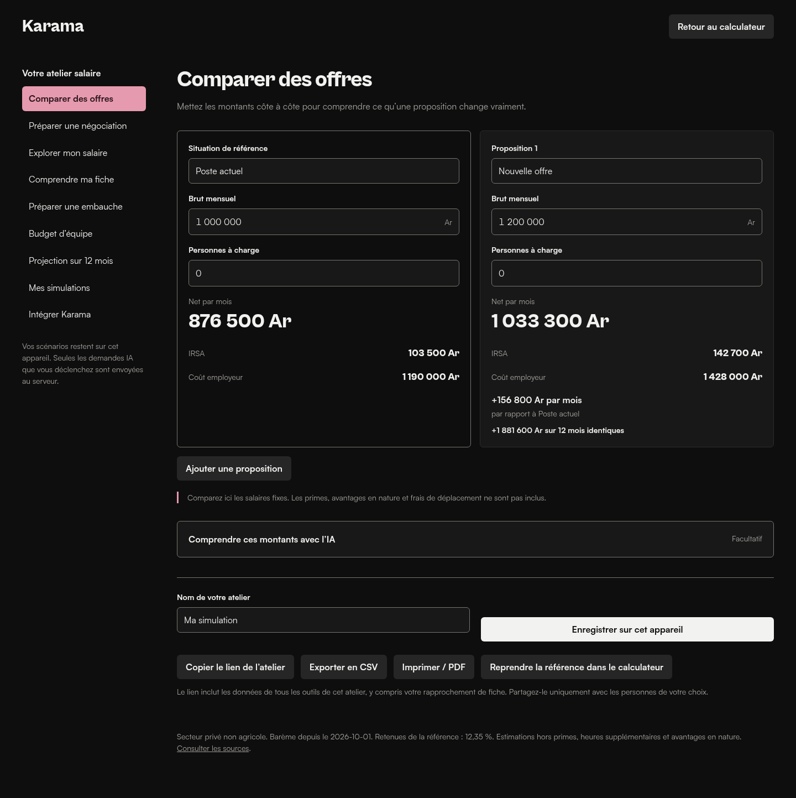
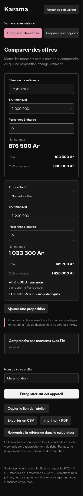

# Karama-Ko

Karama helps people understand, compare and plan fixed salaries in Madagascar. A homepage with an original 3D banknote scene introduces the tools. The gross/net calculator remains directly reachable at `#calculateur`; existing gross/net simulation URLs bypass the homepage. A separate **salary workshop** brings together comparison, negotiation, explanations and employer planning.

Calculations run locally using a shared, tested engine. Saved workshops stay in the browser. An optional server connects an explanatory assistant to a free AI provider (Gemini, Groq, OpenRouter, OpenAI or Anthropic, in the order you choose); the server recomputes the inputs rather than trusting client results.



| Dark theme | Mobile |
| --- | --- |
|  |  |

## What you can do

- Calculate gross → net and net → gross; inspect deductions and employer contributions.
- Compare two to four fixed-salary proposals, with monthly and twelve-month net differences.
- Start from a desired extra net salary to prepare a gross-salary negotiation.
- Explore gross/net evolution using an accessible range control and an explanatory chart.
- Enter payslip amounts manually and compare each line with the engine's estimate. A difference is not treated as proof of an error.
- Start from an employer budget and find the highest whole-Ariary gross salary that fits.
- Build a team budget, duplicate roles, adjust headcounts, and see monthly and twelve-month costs.
- Edit twelve projected months independently. All months explicitly use the October 2026 scale; this is not a historical 2026 payroll calculation.
- Save up to 30 workshops locally, reopen/delete them, and export/import validated JSON snapshots.
- Share complete workshop snapshots in a URL, export the active tool to CSV, or print to PDF.
- Generate a compact iframe widget with a starting salary and light/dark theme.
- Ask an optional AI assistant to explain selected simulations. No automatic salary transmission and no AI-generated calculations.
- Use the core tools offline after the PWA's initial cache is installed. AI requires connectivity.

## Run locally

Node 22.9+ and pnpm are required.

```sh
pnpm install
pnpm dev                 # frontend: http://localhost:5173
pnpm test                # calculation, planning, snapshot and CSV tests
pnpm build               # type-check, frontend/PWA build, shared server engine
```

The calculator and workshop work without an API key or backend.

To enable the optional assistant, with a free provider:

```sh
cp .env.example .env
# Edit .env privately: add at least one key (see below).
pnpm check:ai            # tries every key, prints what works (never the keys)
pnpm dev                 # the site and the assistant, one command: http://localhost:5173
```

`pnpm dev` serves `/api` itself, with the same code as production. `pnpm build && pnpm start` runs the production server instead (it needs `APP_ORIGIN` set to its own address). Keys stay in `.env` or the host's secret manager; never put one in a `VITE_` variable.

### Providers, keys and order

The assistant runs on free tiers or a small top-up. `AI_PROVIDERS` sets the order (`gemini,groq,openrouter,deepseek,xai,openai,anthropic` by default); each provider takes several keys, separated by commas:

```sh
AI_PROVIDERS=groq,gemini,deepseek
GROQ_API_KEYS=key1,key2
GEMINI_API_KEYS=key1,key2,key3
DEEPSEEK_API_KEYS=key1
```

Requests take the keys in turn. A key that is rejected (401/403), out of quota (429) or failing rests for a while and the next one is used, then the next provider; at most six upstream calls per question. When every key is out of quota, the visitor is told that the free allowance is spent. Models: `XAI_MODEL`, `DEEPSEEK_MODEL`, `GEMINI_MODEL`, `GROQ_MODEL`, `OPENROUTER_MODEL`, `OPENAI_MODEL`, `ANTHROPIC_MODEL`; free model names and quotas change, check them in each provider's console. As of November 2026: Gemini's free tier covers `gemini-3.5-flash-lite` (and `gemini-4-hydrogen`, `gemini-3.8-flash`) but the free tier may use your requests to improve Google's products; Groq's free plan covers `qwen/qwen3.8-27b`, `openai/gpt-oss-120b` and `openai/gpt-oss-20b` (30 requests/min, 1,000/day, 8,000 tokens/min); DeepSeek is prepaid, use `deepseek-flash` with thinking disabled (the server does); xAI (Grok) has no free tier.

Limits (`AI_RATE_LIMIT_PER_MINUTE`=5, `AI_RATE_LIMIT_PER_IP_DAY`=20, `AI_DAILY_LIMIT`=100) are kept in memory, per instance: a brake that keeps one visitor from burning a free quota, not a guarantee on a serverless host.

## Deploying on Vercel

1. Import the repository. `vercel.json` sets the build (`pnpm build`), the output (`dist`), the security headers and the two functions (`api/assistant.mjs`, `api/health.mjs`).
2. Add the keys from `.env.example` in *Settings → Environment Variables*. `APP_ORIGIN` is not needed on Vercel (same-origin requests are accepted).
3. `SITE_URL` is optional: the production domain is used for the canonical link, the share previews and `sitemap.xml`. Set it when you add a custom domain.
4. Unknown addresses get `404.html` with a 404 status; the app draws the page.

## Tests

```sh
pnpm test            # engine, planning, scales, workspace
pnpm test:api        # providers, key rotation, limits, server
pnpm test:e2e        # the whole site in a real browser (builds and serves it first)
```

`pnpm test:e2e` uses Playwright with the Chromium already on the machine when there is one, otherwise `pnpm exec playwright install chromium`. It covers every tool, the assistant against a fake server, the legal pages, the 404, SEO tags, security headers, an accessibility scan (axe) in both themes, and phone-size layouts. `node scripts/make-og.mjs` redraws `public/og.png`.

## Production

```sh
pnpm build
# Configure server environment variables, including APP_ORIGIN=https://your-domain.
pnpm start
```

The Node server serves `dist/` and `/api` on port 8787 by default. Use an HTTPS reverse proxy; set `HOST=0.0.0.0` if your host requires a public listener. `PORT`, the provider keys and models, `APP_ORIGIN` and the `AI_*` limits are server settings.

Static hosting of `dist/` remains supported for all non-AI tools. A static-only deployment intentionally leaves the AI unavailable. Public hosting and API credentials are not provisioned by this repository.

The API validates JSON, caps request sizes, rejects cross-origin browser requests, aborts slow upstream calls and applies the limits above. Behind a proxy you control, set `TRUST_PROXY=1` so that `X-Forwarded-For` identifies the visitor.

## Privacy and sharing

- `karama:last` stores the last calculator input; `karama:workspace:v1` stores the current draft; `karama:plans:v1` stores named workshops in localStorage. Clearing browser data removes them.
- A shared workshop URL contains **all workshop inputs**, including manually entered payslip amounts. It is a readable snapshot, not an encrypted or revocable private document. The UI explains this before sharing.
- Workshop payloads live in the URL fragment, which is not part of the HTTP request. Anyone given the link can read them.
- JSON files contain workshop inputs. Imports are size-limited and validated; CSV text is escaped against spreadsheet formula injection.
- Only an explicit AI request sends the selected scenario names, gross salaries, dependant counts and question to the backend. The backend calculates the deductions and sends that context and source references to the configured AI provider; free tiers may keep requests under their own terms. It does not send the other workshop tools or raw payslip rows.
- The application server does not persist prompts, results or salary data. Provider response storage is disabled with `store: false`; this does not imply an exemption from all provider retention policies.
- There are no accounts, analytics, uploaded payslip documents or database.

## Calculation rules and limitations

| Rule | Implemented value | Reference |
| --- | --- | --- |
| Monthly IRSA brackets | 0 %, 5 %, 10 %, 15 %, 20 %, then 25 % above 4 000 000 Ar | CGI art. 01.03.16, Finance Act 2026 |
| Taxable base | Gross minus employee contributions, rounded down to 100 Ar | CGI art. 01.03.16 |
| Minimum tax | 3 000 Ar for a positive gross, including the first bracket | Existing engine's reading of CGI art. 01.03.16 |
| Dependant relief | 2 000 Ar/person above a 350 000 Ar taxable base; minimum still applies | CGI art. 01.03.19 |
| SME | 315 000 Ar since 1 October 2026 | [CNaPS history](https://www.cnaps.mg/historique-sme) |
| Contribution ceiling | 8 × SME = 2 520 000 Ar | CNaPS history |
| CNaPS | 1 % employee / 13 % employer | [CLEISS](https://www.cleiss.fr/docs/cotisations/madagascar.html) |
| OSTIE | 1 % employee / 5 % employer | CLEISS |
| FMFP | 1 % employer | CLEISS |

Reference case: 1 000 000 Ar gross, zero dependants → **876 500 Ar net**.

This release preserves the initial engine's fiscal assumptions. It does not revalidate the legal sources. The CGI text originally came from [Lexxika](https://textes.lexxika.com/droit-malagasy/code-des-impots-2026-2), not the administration's PDF. The minimum-tax interpretation and contribution rules still need independent review against official text and real payslips before payroll use. No real payslip validation has been performed.

Only the scale effective from October 2026 is implemented. Fixed salary only: bonuses, overtime, benefits, reimbursements, absences and historical/future rate changes are excluded. The UI limits dependants to 6 and editable amounts to 1 billion Ar. Low positive gross salaries can yield negative net estimates because of the minimum-tax assumption; they require context and are not full-time wage recommendations.

The tool is an estimate, not a payslip or compliance certificate. The assistant explains the supplied snapshot and explicitly marks an explanation as stale when its inputs change.

## Tests

```sh
pnpm test
pnpm test:api             # builds the shared engine, then runs local HTTP tests
```

The API tests stub the provider, so they do not require a key or spend API credits. Browser validation covers comparison, negotiation, chart, payslip differences, hiring budgets, team editing, annual projection, save/restore, shared URLs, CSV download, invalid imports, iframe operation, mobile layouts and AI explicit-send/stale-result flows. The latter uses a mocked provider; no real model response has been verified without credentials.

## Structure

```text
src/engine/      shared calculations, planning operations and canonical AI context
src/scales/      versioned rates and source references
src/workspace/   workshop panels, local snapshots, chart, assistant and widget
src/components/ calculator interface, breakdown and source tables
src/lib/        formatting and calculator URL/storage state
server/         optional Node HTTP/API server and contract tests
```

React, TypeScript, Vite, Tailwind v4, Vitest and vite-plugin-pwa. Three.js is loaded on demand for the homepage scene; the calculator and workshop do not load the 3D renderer. The scene pauses offscreen and in hidden tabs, caps pixel density, disposes GPU resources on exit, supports reduced motion and has a static fallback. Cabinet Grotesk carries headings and primary figures; Satoshi carries controls and body text. Burgundy marks selections and focus. The animated grid respects reduced motion and is removed from print output.

See [the product case study](docs/CASE_STUDY.md) for the design and engineering decisions.


## Keeping the scale current

The scale lives in `src/scales/` as dated files (`SCALES` in `src/scales/index.ts`). To prepare a change, add the new file there: it takes over on its `effectiveFrom` date, the previous one stays for history, and the site announces it ahead of time. A scale not re-verified for six months shows a warning in every tool.

`pnpm check:sources` compares the official texts behind the scale with saved fingerprints (`src/scales/source-hashes.json`). `.github/workflows/scale-watch.yml` runs it weekly and opens an issue when something moved. Nothing is applied automatically: read the texts, edit the scale, bump `updatedAt`, then run `node scripts/check-sources.mjs --update`.
