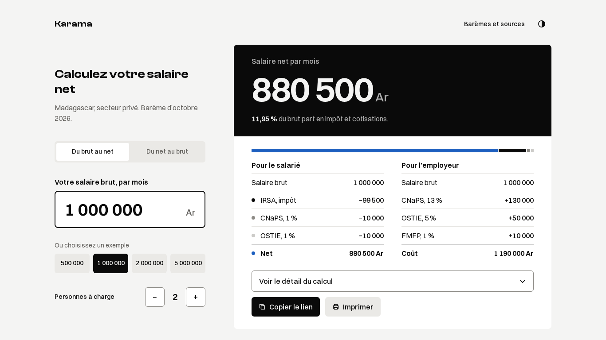
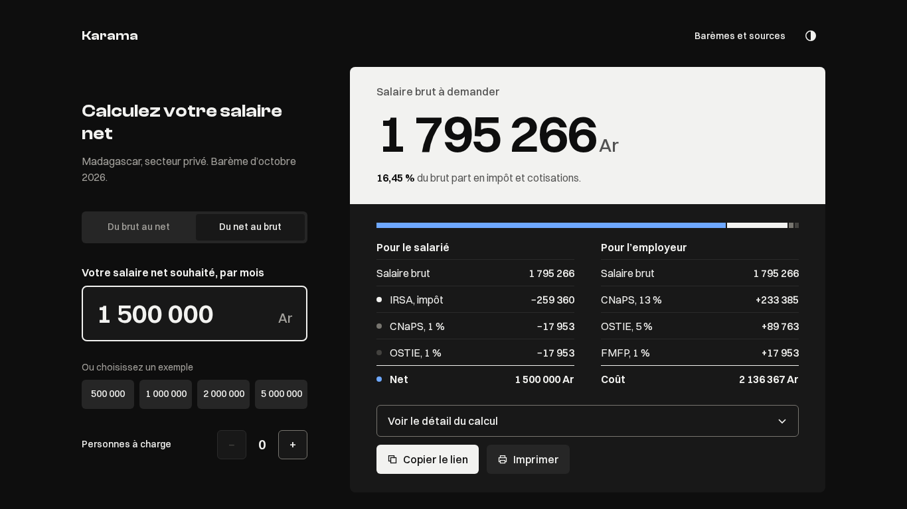
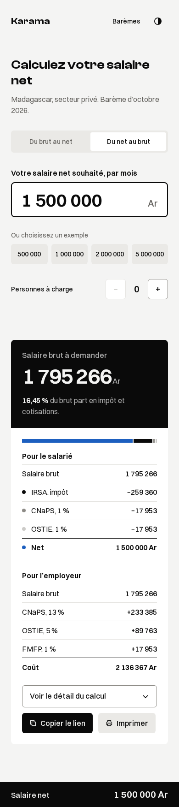

# Karama

Karama ("salary" in Malagasy) turns a monthly gross salary into the net pay for a private-sector, non-agricultural employee in Madagascar. It shows IRSA, CNaPS, OSTIE and the employer cost under the 2026 scale, and can work backwards from a target net.

Everything is computed in the browser. There is no backend, no account and no data collection.



| Net to gross, dark theme | Net to gross, mobile |
| --- | --- |
|  |  |

## Features

- Net pay updates on every keystroke, with the effective rate and a ribbon showing where the gross goes.
- Step-by-step breakdown of the calculation; the full scale and its sources sit at the bottom of the page.
- Employee and employer sides shown next to each other, with CNaPS, OSTIE and FMFP shares and the total cost of the position.
- Net to gross mode, to find the gross to ask for.
- Shareable link (`?brut=1000000&pac=2&vue=employeur`, or `?net=1500000`), native share sheet and a print stylesheet.
- Installable PWA that works offline after the first visit, with light and dark themes.

## Calculation rules

| Rule | Value | Source |
| --- | --- | --- |
| IRSA brackets | 0 % to 350 000 Ar, then 5 %, 10 %, 15 %, 20 %, and 25 % above 4 000 000 Ar | CGI art. 01.03.16, Finance Act 2026 (Loi n° 2025-021) |
| Taxable base | Gross minus employee contributions, rounded down to 100 Ar | CGI art. 01.03.16 |
| Minimum tax | 3 000 Ar, in every bracket | CGI art. 01.03.16 |
| Dependant relief | 2 000 Ar per person, only above a 350 000 Ar base, never below the minimum | CGI art. 01.03.19 |
| SME (minimum wage) | 315 000 Ar since 1 October 2026 | [CNaPS SME history](https://www.cnaps.mg/historique-sme) |
| Contribution ceiling | 8 × SME = 2 520 000 Ar of salary | [CNaPS SME history](https://www.cnaps.mg/historique-sme) |
| CNaPS | 1 % employee, 13 % employer | [CLEISS](https://www.cleiss.fr/docs/cotisations/madagascar.html) |
| OSTIE | 1 % employee, 5 % employer | [CLEISS](https://www.cleiss.fr/docs/cotisations/madagascar.html) |
| FMFP | 1 % employer | [CLEISS](https://www.cleiss.fr/docs/cotisations/madagascar.html) |

Reference case: 1 000 000 Ar gross with no dependant gives 876 500 Ar net.

Known limits:

- The CGI text was read on [Lexxika](https://textes.lexxika.com/droit-malagasy/code-des-impots-2026-2), not on the tax administration's own PDF.
- The SME changed twice in 2026 (300 000 Ar in March, 315 000 Ar in October). Only the scale in force since October is implemented.
- The interface caps dependants at 6. The law sets no cap.
- Bonuses, overtime and benefits in kind are out of scope.
- No result has been cross-checked against a real payslip yet.

The output is an estimate and does not replace a payslip.

## Development

```sh
pnpm install
pnpm dev      # local server
pnpm test     # engine tests (Vitest)
pnpm build    # type-check and production build
```

## Structure

```
src/
├─ engine/      # pure calculation: compute.ts (gross → breakdown), inverse.ts (net → gross)
├─ scales/      # 2026.json: brackets, rates, ceilings, sources
├─ components/  # amount field, result card, breakdown, sources, share actions
├─ lib/         # number formatting, URL and localStorage state
└─ styles/      # design tokens and fonts
```

Adding a year means adding a JSON file in `src/scales/`; the engine takes the scale as a parameter.

## Stack

Vite, React, TypeScript, Tailwind CSS v4, Vitest, vite-plugin-pwa. Fonts: Clash Display for titles and Switzer for text and figures (Fontshare), self-hosted as `woff2`.
