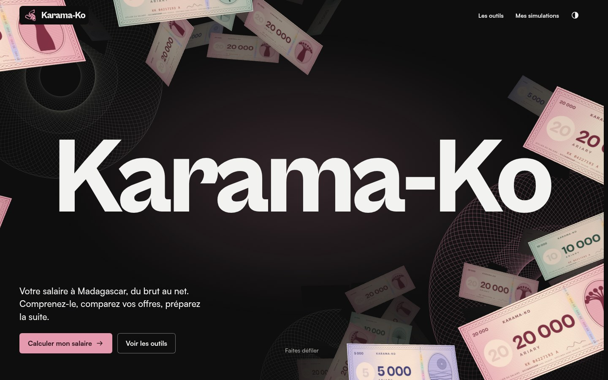
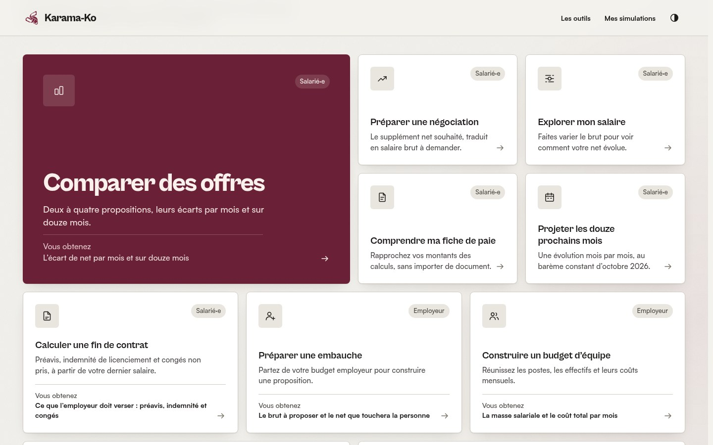
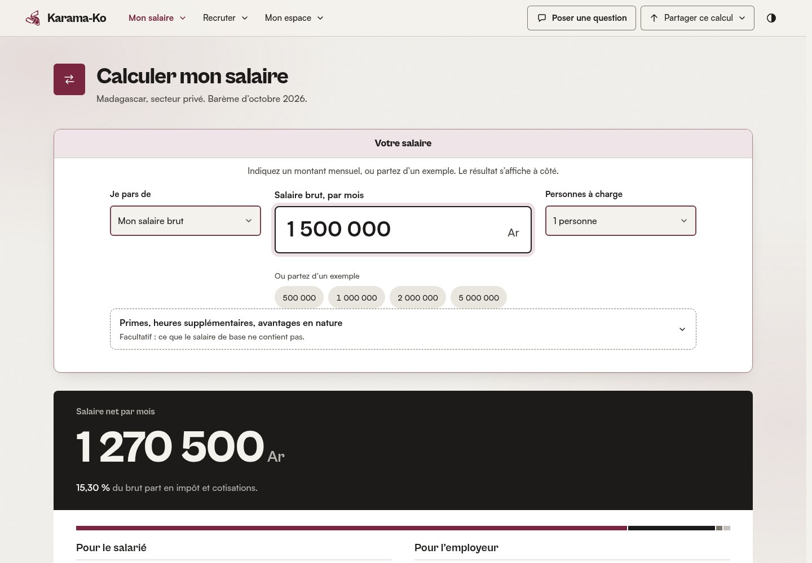
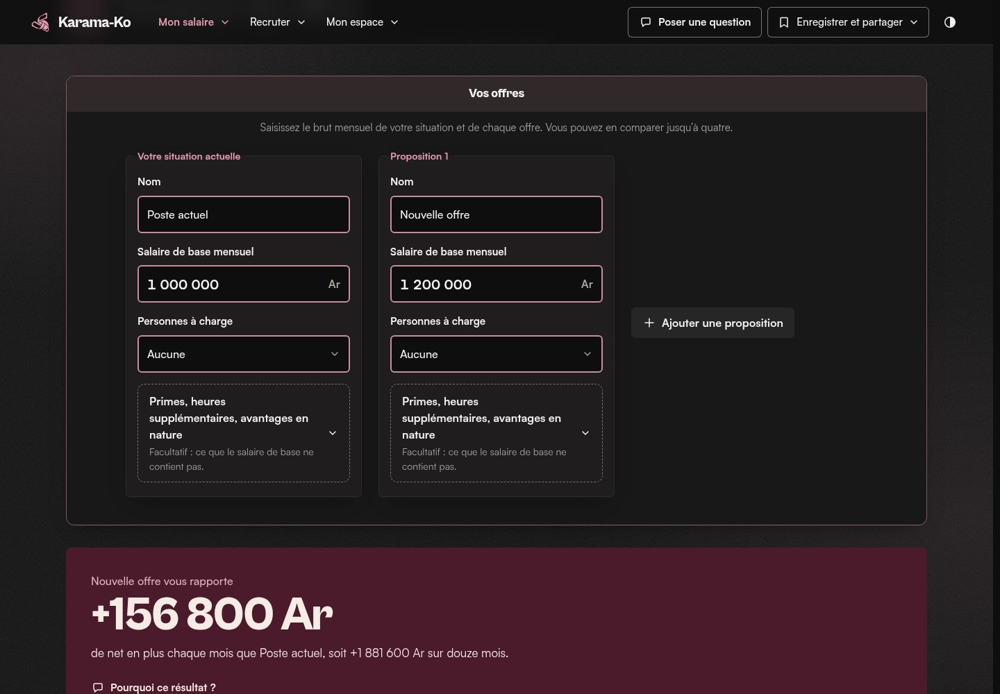
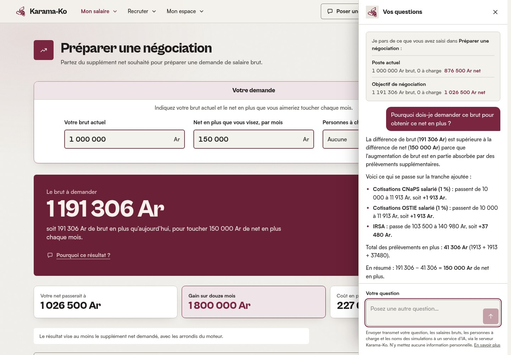
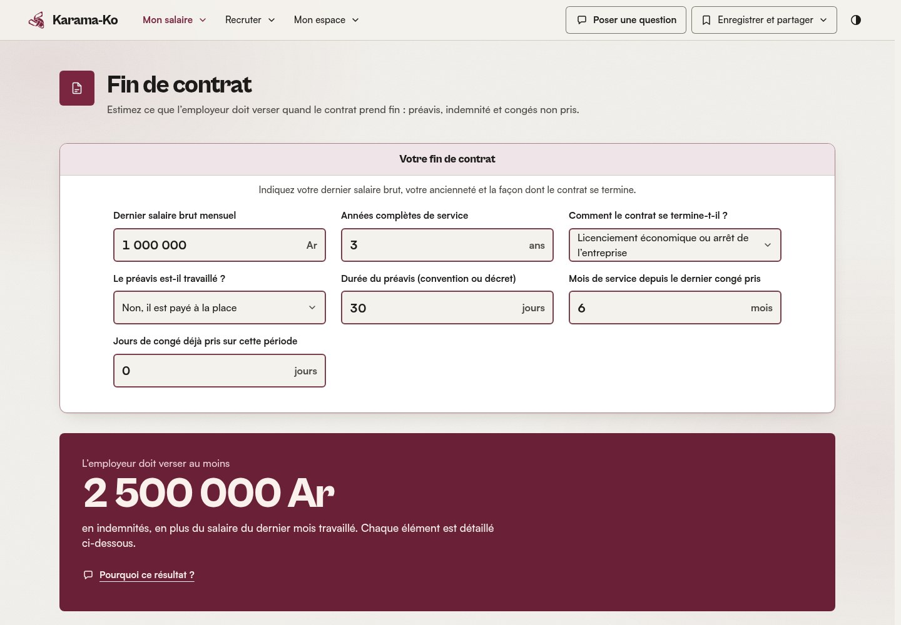
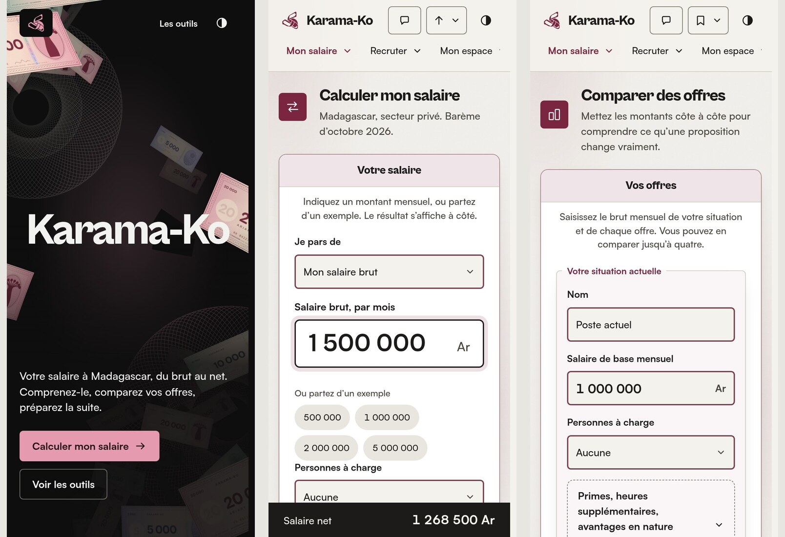

<div align="center">


# Karama-Ko

**Understand, compare and plan a salary in Madagascar.**<br />
Gross ⇄ net, IRSA, CNaPS, OSTIE, offers, negotiation, hiring and end of contract: ten tools, one workshop, calculated in your browser.

            [](https://github.com/TsioryJonathan/karama-ko/actions/workflows/docker.yml)  

<br /><br />



</div>

> *Karama* is the Malagasy word for **salary**, and the suffix *‑ko* means **my**: Karama‑Ko is « my salary ». The interface is in French; the code, comments and documentation are in English.

## What it does

Ten tools share one workshop, so figures flow from one to the next without retyping. Every result comes from one tested engine; nothing is calculated by an AI.

| For an employee | For an employer | Your workspace |
| --- | --- | --- |
| **Calculate** gross → net and net → gross, with bonuses, overtime, night / Sunday / holiday premiums and benefits in kind; OSTIE rates and executive status can be set | **Prepare a hire** from a monthly budget: the salary that fits it | **Saved simulations**, reopened, exported or imported as JSON |
| **Compare** two to four offers, per month and over twelve | **Build a team budget** from roles and headcounts | **Share** a link, export CSV, print to PDF |
| **Prepare a negotiation**: the gross to ask for a net raise | | **Embed** a compact calculator in another site |
| **Explore** how net follows gross, with a chart | | |
| **Understand a payslip**: line-by-line gaps against the calculation | | |
| **Project twelve months**, month by month | | |
| **End of contract**: notice, severance, unused leave | | |

An optional **assistant** explains a result in plain French, in any tool. It only explains the engine's figures; see [How the assistant stays honest](#how-the-assistant-stays-honest). An optional **dashboard** (`/admin`) shows anonymous usage counters: see [docs/METRICS.md](docs/METRICS.md).



## Screenshots

| Calculator | Compare offers (dark) |
| --- | --- |
|  |  |
| **Assistant, with a real answer** | **End of contract** |
|  |  |



## Stack

| | |
| --- | --- |
| **Interface** | React 19, TypeScript, Tailwind CSS 4, a custom accessible select and menus, light and dark themes |
| **Home page** | Three.js scene of original banknotes (loaded on demand, skipped on constrained devices), canvas guilloché |
| **Engine** | Pure TypeScript, shared by the browser, the tests and the assistant API; dated scales with source references |
| **Offline** | PWA (vite-plugin-pwa): the tools work without a connection |
| **Assistant API** | Plain Node (no framework): Gemini, Groq, DeepSeek and others, key rotation, failover, limits, guardrails |
| **Hosting** | Vercel (static site + two functions); the same API also runs as a Node server |
| **Quality** | Vitest, Node test runner, Playwright (end to end, with an axe accessibility scan in both themes and phone layouts) |

## How the assistant stays honest

A model is never trusted to do arithmetic or to stay on topic. Three layers sit around it:

1. **Before the model**: requests for code, and attempts to change or read its rules, get a fixed answer without any model call.
2. **The instructions**: the model may only explain the supplied figures, never produce code, never invent a number.
3. **After the model**: every answer is checked in code. Code or markup, a model leaving its role, and any amount that is not in the visitor's results are rejected; a defective answer is asked again once with the correction, then never shown.

Answers are rendered as formatted text without ever building HTML from them. Providers are tried in the order you set; each can hold several keys that take turns and rest when rejected or out of quota; an exhausted free quota is reported as such.

## Run locally

Node 22.9+ and pnpm are required.

```sh
pnpm install
pnpm dev                 # the site and the assistant: http://localhost:5173
pnpm test                # engine, planning, scales, workspace, markdown
pnpm build               # type-check, site + PWA, shared engine for the API
```

The calculator and every tool work without any key.

To try the dashboard without a database: `METRICS_MEMORY=1 ADMIN_TOKEN=local-password pnpm dev`, then open `/#admin` (counters live in memory and vanish on restart).

### The assistant (optional)

```sh
cp .env.example .env     # then add at least one key
pnpm check:ai            # tries every key and model, never prints a key
pnpm compare:ai          # asks one question to each model: choose the order from the answers
pnpm dev
```

`pnpm dev` serves `/api` itself with the production code, so there is no second server to start. Keys stay in `.env` or the host's secret manager, never in a `VITE_` variable.

`AI_PROVIDERS` sets the order (`gemini,groq,openrouter,deepseek,xai,openai,anthropic` by default); each provider takes several comma-separated keys:

```sh
AI_PROVIDERS=groq,gemini,deepseek
GROQ_API_KEYS=key1,key2
GEMINI_API_KEYS=key1,key2,key3
DEEPSEEK_API_KEYS=key1
```

A key that is rejected (401/403), out of quota (429) or failing rests for a while and the next is used, then the next provider, with at most six upstream calls per question. Models are set by `GROQ_MODEL`, `GEMINI_MODEL`, `DEEPSEEK_MODEL`, `XAI_MODEL`, `OPENROUTER_MODEL`, `OPENAI_MODEL`, `ANTHROPIC_MODEL`. Free models and quotas change: check each provider's console. As of November 2026, Gemini's free tier covers `gemini-3.5-flash-lite` (and `gemini-4-hydrogen`, `gemini-3.8-flash`) but may use your requests to improve Google's products; Groq's free plan covers `qwen/qwen3.8-27b`, `openai/gpt-oss-120b` and `openai/gpt-oss-20b` (30 requests/min, 1 000/day, 8 000 tokens/min); DeepSeek is prepaid (`deepseek-flash`, thinking disabled by the server); xAI has no free tier.

Limits (`AI_RATE_LIMIT_PER_MINUTE`=5, `AI_RATE_LIMIT_PER_IP_DAY`=20, `AI_DAILY_LIMIT`=100) are kept in memory, per instance: a brake that keeps one visitor from burning a free quota, not a guarantee on a serverless host.

## Deploy

Details, the full list of environment variables and a troubleshooting table are in [docs/DEPLOY.md](docs/DEPLOY.md). In short:

| Where | How |
| --- | --- |
| **Vercel** | Import the repository: `vercel.json` sets the build, the headers and the functions. Add the variables you need and **redeploy** (a variable only applies to the next deployment) |
| **Docker** (Render, Fly, Railway, a VPS) | `docker build -t karama-ko .` then `docker run -p 8787:8787 karama-ko` |
| **Docker compose** | `ADMIN_TOKEN=a-long-password docker compose up --build`: the app and a Postgres for the dashboard |
| **Your own server** | `pnpm build && APP_ORIGIN=https://your-domain pnpm start` behind an HTTPS reverse proxy |
| **Static hosting** | Upload `dist/`: every tool works, the assistant and the dashboard do not |

**Behind a proxy** (Render and most hosts), set `APP_ORIGIN=https://your-domain` (otherwise the assistant and the counters answer 403) and `TRUST_PROXY=1` (otherwise every visitor shares the proxy's address and the per-visitor limits). Set the health check to `/api/health`.

The Docker image is multi-stage, runs as a non-root user under `tini`, and has a healthcheck. The *Docker* workflow (`.github/workflows/docker.yml`) builds it on GitHub, runs it, and checks the whole compose stack: a counter goes into Postgres, comes out in the dashboard and survives a restart. Nothing is published.

The dashboard needs a Postgres (Neon, Render, the compose one) with [`docs/metrics.sql`](docs/metrics.sql) applied, plus `DATABASE_URL` and `ADMIN_TOKEN`. Without both, nothing is counted and the dashboard says it is not configured.

## Tests

```sh
pnpm test            # engine, planning, scales, workspace, markdown
pnpm test:api        # providers, key rotation, limits, guardrails, server, counters and dashboard API
pnpm test:e2e        # the whole site in a real browser (builds and serves it first)
```

`pnpm test:e2e` uses Playwright with the Chromium already on the machine when there is one, otherwise `pnpm exec playwright install chromium`. It covers every tool, the assistant against a fake server, the dashboard, the legal pages, the 404, SEO tags, security headers, an accessibility scan in both themes, and phone-size layouts. The API tests stub the providers: no key, no credit spent.

`node scripts/make-screenshots.mjs` redraws the screenshots above; `node scripts/make-og.mjs` redraws the share image.

## Keeping the scale current

The scale lives in `src/scales/` as dated files (`SCALES` in `src/scales/index.ts`). To prepare a change, add the new file there: it takes over on its `effectiveFrom` date, the previous one stays for history, and the site announces it ahead of time. A scale not re-verified for six months shows a warning in every tool.

`pnpm check:sources` compares the official texts behind the scale with saved fingerprints (`src/scales/source-hashes.json`); `.github/workflows/scale-watch.yml` runs it weekly and opens an issue when something moved. Nothing is applied automatically: read the texts, edit the scale, bump `updatedAt`, then run `node scripts/check-sources.mjs --update`.

## Calculation rules and limits

| Rule | Implemented value | Reference |
| --- | --- | --- |
| Monthly IRSA brackets | 0 %, 5 %, 10 %, 15 %, 20 %, then 25 % above 4 000 000 Ar | CGI art. 01.03.16, Finance Act 2026 |
| Taxable base | Gross minus employee contributions, rounded down to 100 Ar | CGI art. 01.03.16 |
| Minimum tax | 3 000 Ar for a positive gross, including the first bracket | Existing engine's reading of CGI art. 01.03.16 |
| Dependant relief | 2 000 Ar/person above a 350 000 Ar taxable base; minimum still applies | CGI art. 01.03.19 |
| SME | 315 000 Ar since 1 October 2026 | [CNaPS history](https://www.cnaps.mg/historique-sme) |
| Contribution ceiling | 8 × SME = 2 520 000 Ar | CNaPS history |
| CNaPS | 1 % employee / 13 % employer | [CLEISS](https://www.cleiss.fr/docs/cotisations/madagascar.html) |
| OSTIE | 1 % employee / 5 % employer | CLEISS |
| FMFP | 1 % employer | CLEISS |
| Night work (22 h to 5 h) | +30 % minimum if habitual, +50 % if occasional; editable | [Décret 68-172](https://papyrus.ilo.org/dyn/natlex/natlex4.detail?p_lang=fr&p_isn=18313), art. 3 as replaced by [décret 72-226](https://www.dgfag.mg/wp-content/uploads/2019/04/DECRET-N%C2%B0-72-226-du-06-juillet-1972.pdf) |
| Sunday work, by day | +40 %; editable | Same |
| Public holiday work, by day | +50 %; editable | Same |

Reference case: 1 000 000 Ar gross, no dependant → **876 500 Ar net**.

Also implemented:

- **Overtime** paid at the hourly rate (monthly salary ÷ 173,33 h, Code du travail art. 75) with premiums you can edit (30 % then 50 % by default), the first 20 hours exempt from IRSA (CGI art. 01.03.03, 9°), counted in the order listed.
- **Night, Sunday and public-holiday hours** inside the normal schedule: only their premium is added to the salary (hours × hourly rate × premium). The decree says these premiums do not add to each other but do add to the overtime premiums, so for hours that are also overtime, add the rates in the overtime lines. These premiums are wages, not overtime: they do not use the 20 exempt hours. The 1 May and 14 October indemnity is not calculated.
- **Executive or « hors catégorie » status**: overtime is not counted. This follows the usual rule that such staff are not paid overtime; it is not backed by a text in this repository, check the contract.
- **OSTIE** employee and employer rates can be edited, down to 0 for a company that does not pay it. Rates and hours accept two decimals. These options are available when starting from a gross salary, and travel in the share link, the saved simulations and the assistant.
- **Bonuses** taxed as salary; **benefits in kind** valued per CGI art. 01.03.08 (housing 50 % of rent capped at 25 % of the base salary, car and phone 15 %, the rest at real value); **severance** 10 days per year capped at six months (Code du travail art. 28) and **leave** at 2,5 days per month (art. 86).

What it cannot know: notice periods (set by collective agreement or decree: you enter them), the real overtime premium of your contract (30 %/50 % is a usual default), the social treatment of benefits in kind and of end-of-contract payments, special regimes, absences and reimbursements. Only the scale in force is implemented. The result is an estimate, not a payslip or a compliance certificate.

## Privacy

- Calculations happen in the browser. Saved simulations, the draft, the last calculation and the theme live in `localStorage`; clearing site data removes them. No account, cookie or third-party analytics.
- Anonymous counters (visits, tools opened, options used, assistant outcomes and timing) are kept in a database, one row per day and name from a fixed list (`server/metrics.mjs`): never an amount, a question, an address or an identifier. Each event is reported once per tab session, and not at all under Do Not Track or Global Privacy Control. The dashboard (`/admin`) shows them behind `ADMIN_TOKEN`. What is counted, what is not, and how: [docs/METRICS.md](docs/METRICS.md).
- A shared link contains all the workshop's inputs in the URL fragment (not sent in HTTP requests). It is a readable snapshot, not a private document.
- Only an explicit assistant request sends the question, the scenario names, gross salaries and dependant counts to the server, which recomputes the figures and forwards them to the configured provider. The server stores nothing; free provider tiers may keep requests under their own terms. The site's legal pages say so in plain language.
- JSON imports are size-limited and validated; CSV cells are escaped against spreadsheet formula injection.

## Structure

```text
src/engine/      calculations, planning, bonuses, overtime and premiums, end of contract, assistant context
src/scales/      dated scales with source references, freshness status, source fingerprints
src/workspace/   tool pages, shared top bar, assistant panel, dashboard, legal pages, 3D home scene
src/components/  calculator parts, extras panel, background fields, error / 404 / loading screens, markdown
src/lib/         link state, number formatting, anonymous counters (page side)
server/          assistant API, counters and dashboard API, Node server, tests
api/             Vercel functions, thin wrappers around server/api.mjs
e2e/             Playwright scenarios
scripts/         source watch, key check, model comparison, screenshots, share image, postbuild
docs/            deployment, counters, case study, brand notes, counters table
Dockerfile       the image (multi-stage, non-root, healthcheck)
compose.yaml     the app and a Postgres for the dashboard
.github/         scale watch (weekly) and Docker CI
```

More: [deployment](docs/DEPLOY.md), [counters and dashboard](docs/METRICS.md), [product case study](docs/CASE_STUDY.md), [brand notes](docs/BRAND.md), [product requirements](PRD.md).

## License

[MIT](LICENSE). The Cabinet Grotesk and Satoshi fonts (Indian Type Foundry, via [Fontshare](https://www.fontshare.com)) keep their own free-font license. The banknotes drawn on the home page are original illustrations marked « specimen », not reproductions of any issued note.
